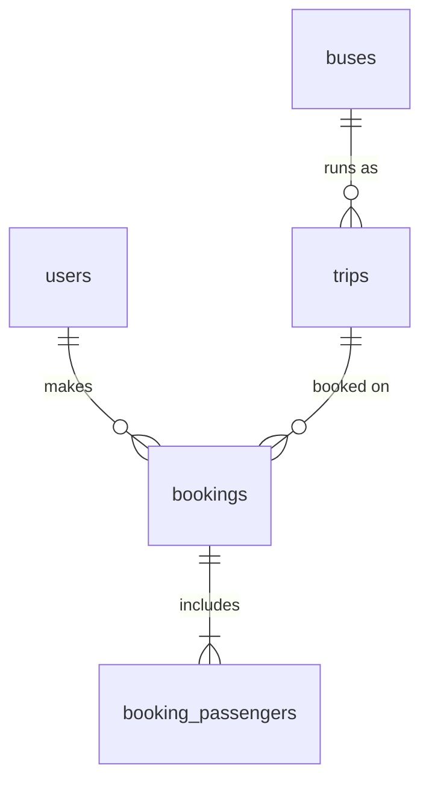

# 🚌 TripZy – Bus Ticket Booking

A full-stack bus ticket booking app built with **React**, **Node.js/Express** and **MySQL**.
Users can search buses by route and date, create an account, book tickets for multiple
passengers and view their bookings. Seats are tracked per bus per travel date.

## ✨ Features

- Account signup / login / logout with **HttpOnly cookie sessions** (JWT); signup logs you in
- Session survives page refresh (restored from the server, nothing stored in `localStorage`)
- Route-aware search: dropdowns are built from the routes that exist in the database
- Results page is URL-driven (`/bus-results?from=…&to=…&date=…`), so refresh and sharing work
- Booking with 1–6 passengers; price is calculated **on the server**
- Seats reduce after each booking, per bus **and per date**; sold-out and departed buses can't be booked
- "My Bookings" per user, loaded from the database
- Protected routes: `/profile`, `/my-bookings`, `/bus/:id`

## 🧱 Tech stack

| Layer | Tech |
|---|---|
| Frontend | React 19, React Router 7, Context API, plain CSS |
| Backend | Node.js (ESM), Express 4, mysql2 (promise pool), bcryptjs, jsonwebtoken, cookie-parser |
| Database | MySQL 8 (relational data, transactions, foreign keys) |

## 🗄️ Database design



- `buses` – a route + timetable (departure/arrival time, price, capacity, days it runs)
- `trips` – one bus on one date, holding `seats_left` (`CHECK seats_left >= 0`); created on first search for that date
- `bookings` / `booking_passengers` – who booked which trip, price at booking time, and passenger details

### Design decisions
- **MySQL, not a document DB:** the data is relational and booking needs ACID transactions.
- **Overbooking prevention:** booking runs in a transaction that locks the trip row (`SELECT … FOR UPDATE`) and updates seats with a guarded `UPDATE`.
- **Server-side pricing and validation:** the client only sends the trip id and passenger list.
- **Sessions:** the browser holds only an `HttpOnly` signed-token cookie; user data stays in the database and is fetched via `GET /api/me`.
- **Timezone-safe "today":** past-date and "already departed" checks use `APP_TIMEZONE` (default `Asia/Kolkata`), not the server's clock.

## 📁 Project structure

```
Bus-Ticket-Booking/
├── backend/
│   ├── server.js                 # API routes
│   ├── db.js                     # MySQL pool + env config
│   ├── routes/auth.js            # register / login / logout / me
│   ├── middleware/authMiddleware.js
│   ├── schema.sql                # tables
│   ├── seed_buses.sql            # sample buses (idempotent)
│   ├── scripts/initDb.js         # npm run db:init
│   └── .env.example
└── frontend/
    └── src/
        ├── api.js                # fetch wrapper (base URL + cookies)
        ├── context/UserContext.js
        ├── components/           # Layout, sideBar, login, Signup, myprofile, ProtectedRoute
        └── pages/                # homePage, busresults, busbooking, mybooking
```

## ⚙️ Setup

**Prerequisites:** Node.js 18.18+ (20 recommended) and a MySQL 8 database.

### 1. Database
Use either:
- **Hosted (recommended):** create a free MySQL service (e.g. Aiven) and note host, port, user, password and database name. Download its CA certificate.
- **Local:** `CREATE DATABASE bus_booking;` in your own MySQL server.

### 2. Backend
```bash
cd backend
cp .env.example .env        # then fill in the values (table below)
npm install
npm run db:init             # creates tables and seeds sample buses (safe to re-run)
npm run dev                 # http://localhost:5000
```

### 3. Frontend
```bash
cd frontend
npm install
npm start                   # http://localhost:3000
```
> Use `localhost` (not `127.0.0.1`) in development so cookies and CORS match.

## 🔧 Environment variables

**backend/.env**

| Variable | Description |
|---|---|
| `PORT` | API port (default `5000`) |
| `CORS_ORIGIN` | Frontend URL(s), comma-separated (default `http://localhost:3000`) |
| `NODE_ENV` | Set to `production` when deployed (enables `Secure`, `SameSite=None` cookies) |
| `APP_TIMEZONE` | Timezone used for "today"/departed checks (default `Asia/Kolkata`) |
| `DB_HOST`, `DB_PORT`, `DB_USER`, `DB_PASSWORD`, `DB_NAME` | MySQL connection |
| `DB_SSL` | `true` for hosted databases that require SSL |
| `DB_CA_PATH` / `DB_CA` | CA certificate file path, or its contents (with `\n`), when `DB_SSL=true` |
| `JWT_SECRET` | Long random string. Generate: `node -e "console.log(require('crypto').randomBytes(48).toString('hex'))"` |

**frontend** (optional): `REACT_APP_API_URL` – API base URL (default `http://localhost:5000`). Set it when building for production.

## 📡 API

| Method | Endpoint | Auth | Description |
|---|---|---|---|
| POST | `/api/register` | – | Create account and start a session |
| POST | `/api/login` | – | Log in (sets the session cookie) |
| POST | `/api/logout` | – | Clear the session cookie |
| GET | `/api/me` | – | Current user, or `{ "user": null }` |
| GET | `/api/routes` | – | Available from/to city pairs |
| GET | `/api/buses?from=&to=&date=YYYY-MM-DD` | – | Trips for a route and date |
| GET | `/api/buses/:id` | – | One trip (`id` = trip id) |
| POST | `/api/book` | ✅ | Book `{ trip_id, passengers: [{ name, age }] }` |
| GET | `/api/bookings` | ✅ | Logged-in user's bookings |

## 🚀 Deployment notes
- Set all backend env vars on your host, run `npm run db:init` once against the production database, and set `NODE_ENV=production`.
- Set `CORS_ORIGIN` to the deployed frontend URL and `REACT_APP_API_URL` to the deployed API URL.
- Cookies work best when frontend and API share a parent domain (e.g. `app.example.com` and `api.example.com`); some browsers block cookies between unrelated domains.

## ⚠️ Known limitations / future work
Payment integration, seat selection, booking cancellation, admin dashboard, email notifications, rate limiting, automated tests.

## 👤 Contributors
- [**Bodike Chaithali**](https://github.com/BodikeChaithali)
- [**Kusuma Teja**](https://github.com/kusumateja16)
- [**Sai Mounika**](https://github.com/KotapatiSaiMounika)

## 🔗 Repository
[**Bus-Ticket-Booking**](https://github.com/BodikeChaithali/Bus-Ticket-Booking/)